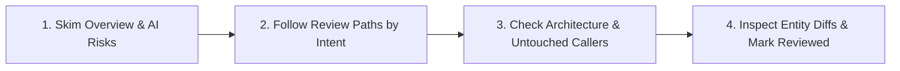

<p align="center">
  
</p>

<h1 align="center">PatchVista</h1>

<p align="center">
  <strong>Transform complex, multi-file diffs into an interactive, guided review journey.</strong><br>
  Agent Skill for AI coding assistants · Interactive impact & architecture map · Zero-dependency offline HTML report
</p>

<p align="center">
  <strong>English</strong> ·
  <a href="README.zh-CN.md">简体中文</a>
</p>

<p align="center">
  <a href="#quick-start">Quick Start</a> ·
  <a href="#what-you-get">Key Features</a> ·
  <a href="#how-to-review">Review Workflow</a> ·
  <a href="docs/usage.en.md">Usage Guide</a> ·
  <a href="#supported-languages--stack">Supported Stack</a> ·
  <a href="#data--privacy">Privacy</a>
</p>

---

When an AI coding assistant refactors code across dozens of files, **where do you even start reviewing?**

- Which changes represent core business logic versus boilerplate renames or imports?
- When a function signature changes, which downstream callers were left untouched?
- Did this pull request introduce hidden side effects to database tables, Redis keys, or message queues?

**PatchVista** solves this. It inspects Git branches, commits, or working tree diffs, extracts AST entities, builds static call graphs, and identifies middleware and resource dependencies. Your AI assistant then contributes high-level intent explanations, a recommended reading order, and risk analysis.

The result is a **self-contained, interactive HTML review report**. Open it directly in your browser—no local server, background service, or external network requests required.

<p align="center">
  <picture>
    <source media="(prefers-color-scheme: dark)" srcset="docs/assets/report-dark.png">
    
  </picture>
  <br>
  <sub>Real report from an e-commerce checkout refactor. Features instant English/Chinese switching, dark/light themes, and system appearance sync.</sub>
</p>

## What You Get

| Review Challenge | How PatchVista Solves It |
| --- | --- |
| **"What is this pull request trying to do?"** | The AI groups cross-file changes into intent-driven **Review Paths (Change Sets)** with concise summaries and recommended reading order. |
| **"What else does this touch or break?"** | Interactive **module and entity dependency graphs** visualize upstream callers, downstream callees, and database/cache resources, clearly distinguishing modified code from untouched context. |
| **"Which lines actually changed?"** | Entity-scoped diffs for functions, methods, classes, and types highlight **signature modifications** and provide one-click jump to local VS Code, Cursor, or JetBrains. |
| **"Are there hidden bugs or regressions?"** | Combines rule-based static checks with AI reasoning to flag untouched callers after signature breaks, deleted configs still referenced, and untested modifications. |
| **"Where did I leave off?"** | Search file paths, filter by file extension, navigate with keyboard shortcuts (`j`/`k`), and mark items as reviewed (`r`). Progress persists in your local browser storage. |
| **"Can I archive or share this offline?"** | Generates a single, standalone `report.html` embedding all scripts, styles, icons, and fonts. Works completely offline with zero external CDNs. |

## Quick Start

### 1. Prerequisites

- **Node.js 22.20+** (Node 24 LTS recommended, with npm) and **Git**.
- An AI coding assistant that supports Agent Skills and local command execution (e.g., Claude Code, Cursor, Codex, Antigravity, etc.).
- A local Git clone of the repository you want to review.
- Internet connectivity is only needed during initial dependency installation; generated reports operate 100% offline.

### 2. Install the Skill

Install PatchVista from its local source directory. In the **root directory of the project you want to review**, run (replacing the path with the absolute path to your PatchVista repository):

```bash
npx skills add /absolute/path/to/patchvista --skill patchvista
```

Follow the interactive prompt to choose your AI assistant. By default, this installs into the current workspace; add `-g` to install as a global user skill.

> **Tip**: Install from a clean source checkout (free of `.local/`, `node_modules/`, or private reports). If installing from an active development checkout, consult the [Contributing Guide](CONTRIBUTING.md#clean-source-copy).

### 3. Prompt Your Assistant to Generate a Report

In your target project, prompt your AI assistant:

```text
Use patchvista to review the changes in the current branch against main.
Generate an interactive HTML report, group changes by intent, and highlight recommended reading order and major risks.
```

Your AI assistant will install runtime dependencies on first run, collect diff facts, generate semantic analysis, render the HTML file, and return the absolute path to `report.html`.

**Simply open `report.html` in your browser to begin your review!**

<details>
<summary><strong>More Ready-to-Use Prompt Examples</strong></summary>

**Compare two branches (e.g. Pull Request view)**

```text
Use patchvista to compare dev against main, focusing on interface contract changes and untouched callers.
```

**Inspect a specific commit**

```text
Use patchvista to review commit abc1234, generate a report, and identify behavioral changes that require new unit tests.
```
*(Replace `abc1234` with your commit SHA)*

**Inspect uncommitted changes in your working tree**

```text
Use patchvista to review uncommitted working tree changes and suggest an optimal reading order.
```

</details>

## How to Review

Follow this recommended 4-step workflow to review code efficiently:



1. **Skim Overview & Key Risks**: Review top-level metrics, summary notes, and flagged high/medium risks in the right-hand panel.
2. **Follow Review Paths by Intent**: Walk through the "Review Paths" in the left panel. Changes are organized by logical purpose rather than scattered alphabetical filenames.
3. **Inspect Upstream & Downstream Impact**: Click on any node in the graph to inspect relationships. Double-click to focus its upstream callers and downstream dependencies. Pay close attention to **untouched callers** highlighted in orange.
4. **Inspect Diffs & Track Progress**: Review the focused diff for each function or class. Press `r` to mark as reviewed, and press `j` / `k` to jump to the next item.

> **Keyboard Shortcuts**: In change set mode, use `j` / `k` to cycle through entities and `r` to toggle reviewed status. Toggle languages between **EN** and **中文** or switch themes (**Light** / **Dark** / **System**) anytime in the top bar.

For manual CLI invocation, custom comparison ranges (`..` vs `...`), or incremental re-rendering, see the [Usage Guide](docs/usage.en.md).

## Supported Languages & Stack

| Language / Area | Extraction & Analysis Capability |
| --- | --- |
| **TypeScript / JavaScript** | Deep AST entity extraction for functions, classes, methods, interfaces, types, and enums; precise static call graphs powered by TypeScript LanguageService. |
| **Go / Python** | Tree-sitter AST extraction for core code entities; symbol- and scope-aware reference resolution. |
| **SQL, Config & Middleware** | Heuristic rule-based detection for SQL tables (CRUD / schema alterations), Redis keys, message queue topics, environment configs, HTTP routes, and cron jobs. |

*Note: Static analysis operates on resolvable project context. Dynamic reflection, runtime dependency injection, or dynamic string evaluation may not be fully resolved. Risk flags are recommendations to assist human judgment; PatchVista does not execute repository test suites.*

## Data & Privacy

- **100% Local Processing**: AST parsing, static analysis, and HTML report assembly run entirely on your local machine. No code is transmitted to external PatchVista servers.
- **AI Analysis Depends on Your Assistant**: Semantic summaries and risk insights are produced by your configured AI tool and model provider. When using remote models, code digests and diff snippets are subject to your provider's privacy policy.
- **Report Security**: Generated `report.html`, `facts.json`, and `digest.md` files contain source code and repository paths. Ensure reports comply with your organization's confidentiality standards before sharing externally.

## Documentation & Contributing

- [Usage Guide](docs/usage.en.md) ([中文版](docs/usage.md)): Command-line flags, comparison ranges, updating existing reports, and FAQ.
- [Skill Workflow Guide (SKILL.md)](SKILL.md): Complete workflow instructions used by AI assistants.
- [Analysis Schema](references/analysis-schema.md): Data specification for custom `analysis.json` generation.
- [Contributing Guide](CONTRIBUTING.md): Development setup, automated testing, and release checklist.

## License

PatchVista source code and skill documentation are licensed under the [ISC License](LICENSE). Third-party vendored assets (Lucide icons, Cytoscape, ELK, etc.) are governed by their respective licenses; see [Distribution Notes](CONTRIBUTING.md#licensing-and-distribution-audit).
