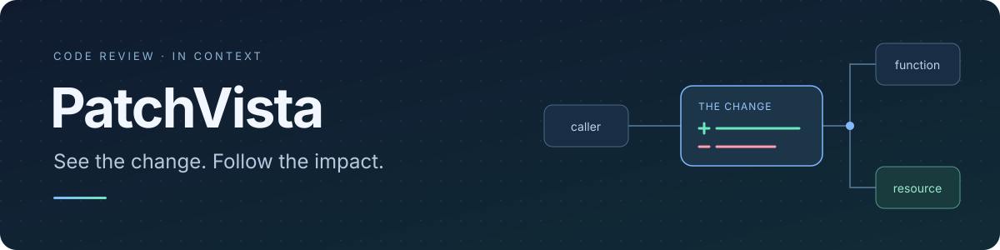
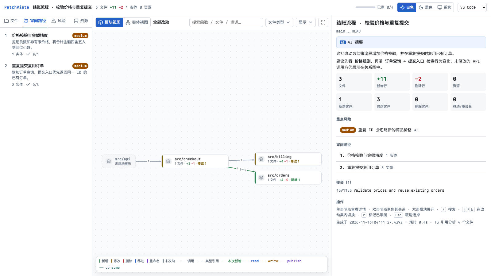

<p align="center">
  
</p>

<h1 align="center">PatchVista</h1>

<p align="center">
  <strong>把一大批 diff，变成一条看得懂的审阅路线。</strong><br>
  为 AI 编程助手提供的 Agent Skill · 交互式关系图 · 离线 HTML 报告
</p>

<p align="center">
  <a href="#快速开始">快速开始</a> ·
  <a href="#你会得到什么">功能预览</a> ·
  <a href="docs/usage.md">使用指南</a> ·
  <a href="#支持范围">支持范围</a>
</p>

---

AI 一次改了几十个文件，应该先看哪里？函数签名变了，哪些调用方还没动？一个改动又牵涉了哪些数据库、缓存或队列？

**PatchVista** 把 Git 分支、提交或工作区改动整理成一份交互式审阅报告。脚本提取代码实体、静态引用与资源关系，你的 AI 助手补充改动意图、审阅顺序与风险。打开一个 HTML 文件，就能从全局关系一路看到具体 diff。

<p align="center">
  <picture>
    <source media="(prefers-color-scheme: dark)" srcset="docs/assets/report-dark.png">
    
  </picture>
  <br>
  <sub>自建结账示例的实际报告。支持浅色、深色和跟随系统外观。</sub>
</p>

## 你会得到什么

| 你想知道 | 报告如何帮助你 |
| --- | --- |
| **这批改动在做什么？** | AI 按意图跨文件分组，并给出每组摘要和建议审阅顺序。 |
| **改动会影响哪里？** | 在模块或实体关系图中查看调用方、被调方及识别到的资源；区分本次修改和未修改的代码。 |
| **具体改了哪几行？** | 查看函数、类、接口等实体的 diff、签名变化和调用关系，也可跳转本地编辑器。 |
| **哪些地方值得重点看？** | 将 AI 风险分析和规则提示放在相关改动旁，方便回到代码核实。 |
| **我看到哪里了？** | 搜索文件、按类型筛选、逐项标记已审；审阅进度保存在当前浏览器中。 |
| **能否离线阅读？** | 生成单文件 `report.html`，内嵌脚本、样式、图标与字体，无需启动服务器。 |

## 快速开始

### 1. 准备环境

- **Node.js 22.20+**（推荐 24 LTS，含 npm）和 **Git**。
- 一个能加载 Agent Skills、执行本地命令的 AI 编程助手。
- 待审 Git 仓库的本地副本；要比较的分支或提交需已存在于本地。
- 安装技能工具及首次安装依赖时需要网络；生成后的报告可离线阅读。

### 2. 安装技能

当前通过本地源码安装。拿到源码后，在**你要审阅的项目目录**执行，将路径替换为 PatchVista 源码的绝对路径：

```bash
npx skills add /absolute/path/to/patchvista --skill patchvista
```

按提示选择 AI 助手；默认安装到当前项目，加 `-g` 可安装到用户级目录。源码根目录应包含 `SKILL.md`、`scripts/` 和 `references/`。

> 请使用不含 `.local/`、`node_modules/` 和私有报告的干净源码目录。本地安装工具的复制规则不等同于 `.gitignore`。从开发目录安装时，先按[贡献指南](CONTRIBUTING.md#准备干净源码副本)准备副本。

### 3. 让助手生成报告

在待审项目中告诉助手：

```text
使用 patchvista 审阅当前分支相对 main 的改动。
生成交互式 HTML 报告，按改动意图分组，说明建议审阅顺序和主要风险。
```

助手会在首次运行时安装技能依赖，然后完成采集、分析和渲染，返回 `report.html` 的路径。**用浏览器打开这个文件即可开始审阅。**

依赖安装在技能目录中，不会写入待审项目的 `package.json`。你无需手写分析 JSON，也无需为 PatchVista 单独配置模型密钥；语义分析由当前 AI 助手完成。

<details>
<summary><strong>更多可以直接使用的提示词</strong></summary>

**比较两个分支**

```text
使用 patchvista 比较 dev 相对 main 的改动，重点检查接口变化及未修改的调用方。
```

**检查单个提交**

```text
使用 patchvista 审阅提交 abc1234，生成报告，并标出需要补充测试的行为变化。
```

将 `abc1234` 换成实际提交哈希。

**检查未提交的改动**

```text
使用 patchvista 审阅当前工作区尚未提交的改动，给出建议阅读顺序。
```

</details>

## 怎么阅读报告

1. **看摘要和风险。** 先了解这批改动的目标与需要核实的问题。
2. **沿审阅路径阅读。** 每个改动集对应一个意图，可以跨越多个文件。
3. **顺着关系检查影响。** 单击节点查看详情，双击聚焦上下游；按需显示调用方、资源或测试。
4. **回到 diff 做判断。** 检查签名和行为变化，标记已审，继续下一项。

在改动集中用 `j` / `k` 浏览实体，`r` 标记已审。主题和审阅进度在浏览器存储可用时自动保存。分享 HTML 不会同步这些本地进度。

需要命令行运行、严格比较两个分支端点或更新已有报告？见[使用指南](docs/usage.md)。

## 支持范围

| 语言 / 对象 | 分析方式 |
| --- | --- |
| **TypeScript / JavaScript** | 提取代码实体，使用 TypeScript LanguageService 查找静态引用。 |
| **Go / Python** | 提取代码实体，按名称匹配引用；可能出现同名误匹配或遗漏。 |
| **SQL、配置及资源使用** | 用规则识别数据库、Redis、消息队列、配置、路由等关系。 |

静态分析依赖可解析的项目上下文；动态调用、反射、依赖注入和动态字符串可能无法识别。风险提示应结合 diff 核实；PatchVista 不执行项目测试。

## 数据与隐私

采集与 HTML 渲染在本机完成。**AI 分析的数据流取决于你使用的助手和模型服务**；使用远程模型时，代码摘要与相关源码可能被发送给该服务。

`facts.json`、`digest.md`、`analysis.json` 和 HTML 报告可能包含源码、内部配置及本机路径。请按源仓库的保密要求检查后再分享。

## 文档与贡献

- [使用指南](docs/usage.md)：命令行、比较范围、更新报告与常见问题。
- [Agent 执行说明](SKILL.md)：助手生成报告时使用的工作流。
- [分析格式](references/analysis-schema.md)：自定义 `analysis.json`。
- [贡献指南](CONTRIBUTING.md)：开发、测试和发布检查。

## 许可证

项目代码与技能文档使用 [ISC](LICENSE)；第三方组件适用各自许可证，详见[分发说明](CONTRIBUTING.md#许可证与发布检查)。
