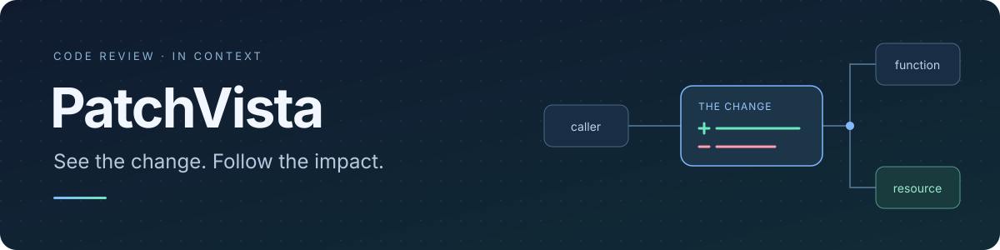
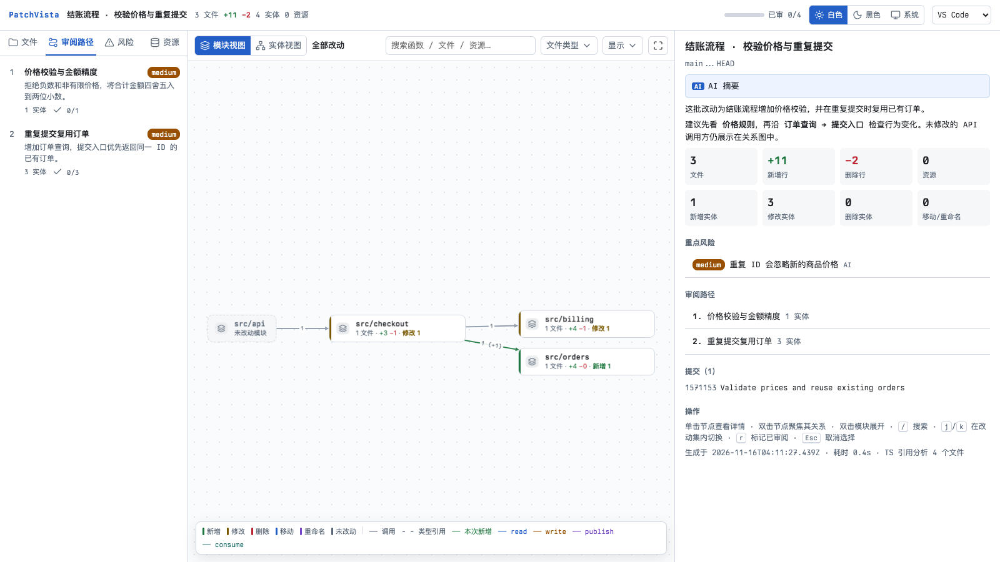
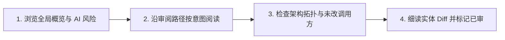

<p align="center">
  
</p>

<h1 align="center">PatchVista</h1>

<p align="center">
  <strong>把成百上千行的复杂 Diff，梳理成清晰易读的审阅路线。</strong><br>
  面向 AI 编程助手的 Agent Skill · 交互式代码影响图 · 零依赖单文件 HTML 报告
</p>

<p align="center">
  <a href="README.md">English</a> ·
  <strong>简体中文</strong>
</p>

<p align="center">
  <a href="#快速开始">快速开始</a> ·
  <a href="#你会得到什么">核心功能</a> ·
  <a href="#如何阅读报告">审阅方法</a> ·
  <a href="docs/usage.md">使用指南</a> ·
  <a href="#支持范围">支持语言</a> ·
  <a href="#数据与隐私">隐私说明</a>
</p>

---

当 AI 编程助手一次性修改了数十个文件、数百行代码时，**我们究竟应该从哪里看起？**

- 哪些是核心业务逻辑的改动，哪些只是机械式的重命名或路径迁移？
- 某个函数签名被改动后，下游究竟还有哪些调用方未被同步更新？
- 这批改动是否悄悄波及了数据库表结构、Redis 缓存 Key 或消息队列消费？

**PatchVista** 为此而生。它提取 Git 分支、提交或工作区改动的 AST 实体、静态引用和中间件/数据库依赖关系，并由你的 AI 助手补充改动意图、最佳阅读顺序与潜在风险。

最终输出一份**完全独立、离线可用的交互式 HTML 审阅报告**。无需启动任何服务器，直接在浏览器中打开，即可从全局架构拓扑自顶向下穿透至每一行具体 diff。

<p align="center">
  <picture>
    <source media="(prefers-color-scheme: dark)" srcset="docs/assets/report-dark.png">
    
  </picture>
  <br>
  <sub>真实电商结账系统的审阅报告示例。支持中英文双语即时切换、浅色/深色外观和系统偏好跟随。</sub>
</p>

## 你会得到什么

| 审阅痛点 | PatchVista 如何帮你解决 |
| --- | --- |
| **这批改动到底在做什么？** | AI 按业务意图跨文件归纳为**审阅路径（Change Sets）**，附带每组核心摘要与推荐阅读次序。 |
| **改动会波及哪些上下游？** | 交互式**模块与实体架构图**清晰标注调用方、被调用方及数据库/缓存资源，直观区分本次修改与既有未改代码。 |
| **具体改动了哪几行代码？** | 针对函数、类、接口等实体的精细 Diff，高亮**签名变动**，并支持一键在本地 VS Code / Cursor / JetBrains 中打开。 |
| **存在哪些潜在风险与遗漏？** | 结合静态分析规则与 AI 语义推理，实时告警未修改调用方、配置删除仍被引用、缺少对应测试等高危隐患。 |
| **审阅进度如何跟踪？** | 支持文件模糊搜索、类型过滤、快捷键导航（`j`/`k`）与已审标记（`r`）；进度实时保存在本地浏览器中。 |
| **报告能否离线分享与归档？** | 生成**单一静态 HTML 文件**，内嵌所有脚本、样式、图标与字体，不依赖外网环境，随开随看。 |

## 快速开始

### 1. 准备环境

- **Node.js 22.20+**（推荐 Node 24 LTS，含 npm）和 **Git**。
- 支持加载 Agent Skills、具备本地命令执行能力的 AI 编程助手（如 Claude Code、Cursor、Codex、Antigravity 等）。
- 待审 Git 仓库的本地副本（分支或提交需已存在于本地）。
- 仅在首次安装技能运行依赖时需要网络；生成后的报告完全离线运行。

### 2. 安装技能

通过本地源码安装。获取 PatchVista 源码后，在**你要审阅的项目目录**中执行以下命令（将路径替换为 PatchVista 源码的绝对路径）：

```bash
npx skills add /absolute/path/to/patchvista --skill patchvista
```

按终端提示选择你的 AI 助手；默认安装到当前项目，添加 `-g` 参数可安装为全局用户技能。

> **提示**：安装时请使用干净的源码目录（不含 `.local/`、`node_modules/` 等构建或私有产物）。如需从开发目录安装，请先参考[贡献指南](CONTRIBUTING.md#准备干净源码副本)准备副本。

### 3. 让 AI 助手生成报告

在待审项目中直接向你的 AI 助手发送指令：

```text
使用 patchvista 审阅当前分支相对 main 的改动。
生成交互式 HTML 报告，按改动意图分组，说明建议审阅顺序和主要风险。
```

AI 助手会在首次运行时自动安装依赖，并完成代码采集、意图分析和 HTML 渲染，最后返回 `report.html` 的绝对路径。

**直接用浏览器打开该文件，即可开始顺畅审阅！**

<details>
<summary><strong>更多常用提示词示例</strong></summary>

**比较两个分支（如合并请求 / PR 视角）**

```text
使用 patchvista 比较 dev 相对 main 的改动，重点检查接口契约变化及未修改的调用方。
```

**检查单个特定提交**

```text
使用 patchvista 审阅提交 abc1234，生成报告，并标出需要补充测试或有回归风险的行为变化。
```

*（将 `abc1234` 替换为实际提交哈希）*

**检查当前工作区未提交的代码**

```text
使用 patchvista 审阅当前工作区尚未提交的代码改动，给出建议的阅读顺序。
```

</details>

## 如何阅读报告

建议按照以下工作流高效审查代码：



1. **先看摘要与风险**：在概览面板中快速了解本次改动的业务目标、关键指标与潜在隐患。
2. **沿审阅路径阅读**：左侧「审阅路径」已将跨文件改动按功能归类，无需在散落的文件列表中反复横跳。
3. **结合拓扑检查影响**：单击实体查看详细调用关系与使用的资源；双击可快速聚焦上下游。特别留意**橙色高亮的未改动调用方**。
4. **深入 Diff 并记录进度**：直接查看函数/类级别的代码变更，按 `r` 标记已审，按 `j` / `k` 前往下一个实体。

> **快捷键提示**：在改动集中使用 `j` / `k` 切换实体，`r` 标记已审/取消已审。报告右上角可一键切换中英文（EN / 中文）及浅色/深色主题。

更多关于命令行手动运行、精确端点对比（`..` vs `...`）或更新报告的方法，请参阅[使用指南](docs/usage.md)。

## 支持范围

| 语言 / 生态 | 提取与分析能力 |
| --- | --- |
| **TypeScript / JavaScript** | 深度提取函数、类、方法、接口、类型与枚举实体；使用 TypeScript LanguageService 构建精确的静态调用图。 |
| **Go / Python** | 基于 Tree-sitter 提取代码实体；按作用域与符号名称匹配引用关系。 |
| **SQL、配置与中间件资源** | 基于启发式规则自动识别数据库表（CRUD / Schema）、Redis 缓存、消息队列、环境变量、HTTP 路由及定时任务。 |

*注：静态分析依赖本地可解析的项目上下文；反射、依赖注入、动态字符串拼接可能无法完全识别。风险提示旨在辅助人工核查，PatchVista 不会代为执行项目测试套件。*

## 数据与隐私

- **100% 本地分析与生成**：代码 AST 提取、静态引用分析和 HTML 报告拼装全流程均在你的本地机器上完成，不向任何第三方服务上传代码。
- **AI 语义分析取决于你的配置**：AI 助手的语义总结与风险识别取决于你所使用的 AI 工具及对应模型提供商。使用云端大模型时，代码摘要与部分 diff 片段会按你的助手配置传输至模型。
- **报告归属与安全性**：生成的 `report.html`、`facts.json` 和 `digest.md` 可能包含源码和内部路径。在与外部团队分享报告前，请确认符合贵司的数据合规要求。

## 相关文档

- [使用指南](docs/usage.md)：CLI 参数、比较范围选择、更新已有报告与常见问题。
- [Agent 执行规范 (SKILL.md)](SKILL.md)：AI 助手生成报告时的完整工作流说明。
- [分析结构定义 (Schema)](references/analysis-schema.md)：自定义 `analysis.json` 数据格式规范。
- [贡献指南](CONTRIBUTING.md)：本地开发、测试执行与发版检查清单。

## 许可证

本项目源码与技能文档遵循 [ISC 许可证](LICENSE)。报告内置的第三方组件遵循其各自的开源许可协议，详见[分发说明](CONTRIBUTING.md#许可证与发布检查)。
